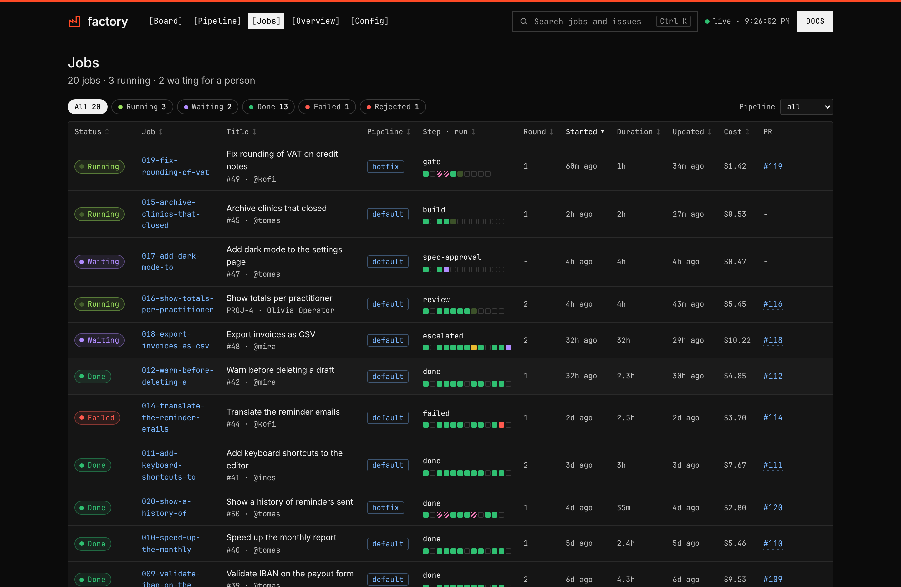
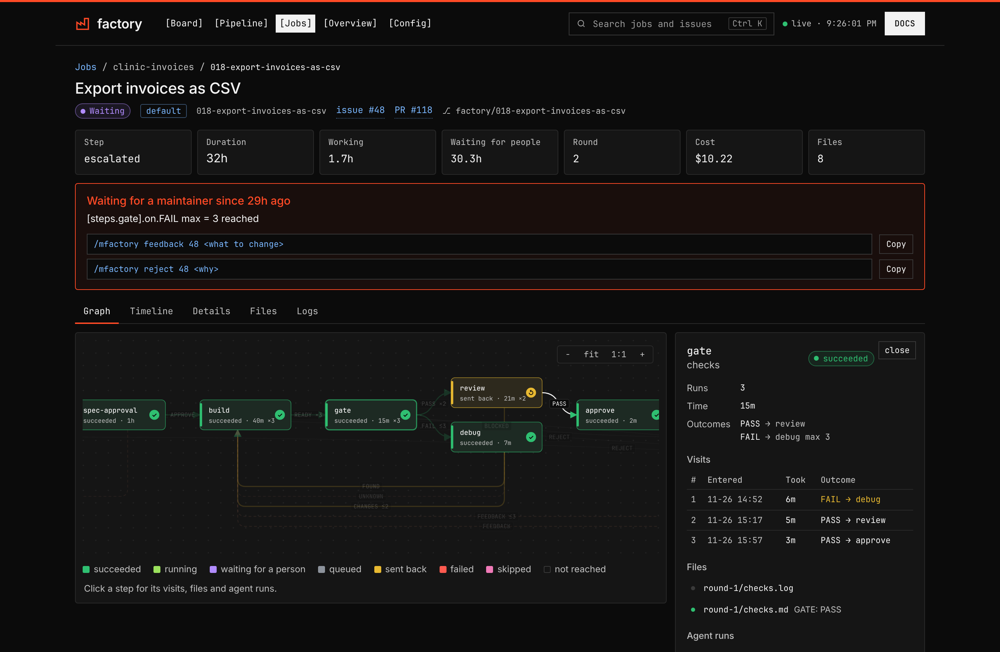

# modular-factory

[](https://github.com/danielsmag/modular-factory/actions/workflows/ci.yml)
[](https://www.python.org/downloads/)
[](LICENSE)

A software factory you install into any repository. Label a GitHub issue.
Agents decide whether it is worth building, write a spec, build it on a branch,
and review it. By default a maintainer merges the pull request. A project can
turn the merge step on so the factory merges it.

It runs inside the coding tool you already use: Claude Code, Cursor, or Codex.
Everything a project changes lives in `factory/`: pipelines as YAML in
`factory/pipes/`, and the rest in `factory/factory.toml`.

**[Documentation](https://danielsmag.github.io/modular-factory/docs/)**


> **Status: not yet run inside a real tool.** Automated tests play the
> orchestrator and the agents against a stand-in for GitHub. Nobody has yet
> run a job end to end in Claude Code, Cursor, or Codex. Expect problems on
> the first real run. See [what is untested](docs/design.md#what-is-untested).

## Contents

- [Requirements](#requirements)
- [Install](#install)
- [Use](#use)
- [Pipeline](#pipeline)
- [Planner](#planner)
- [Dashboard](#dashboard)
- [Documentation](#documentation)
- [Development](#development)
- [Licence](#licence)

## Requirements

- Python 3.11 or later
- `git`
- GitHub CLI [`gh`](https://cli.github.com/), signed in (`gh auth login`)
- One of Claude Code, Cursor, or Codex

The factory adds nothing to the project's dependencies. Pipelines need PyYAML.
`install.sh` installs it when it is missing, and `mfactory doctor` checks for it.

## Install

Install the `mfactory` command once:

```bash
curl -fsSL https://raw.githubusercontent.com/danielsmag/modular-factory/master/install.sh | bash -s -- --global
```

Read the script before you pipe it to a shell. The [install guide](docs/install.md)
has the download-first commands and every flag.

Then, in each repository:

```bash
mfactory install --tool claude
```

Use `--tool cursor` or `--tool codex` instead, or repeat `--tool` for several.
In your coding tool:

```text
/mfactory setup
```

That reads the project and fills in `factory/factory.toml`: what the project is
for, and the commands that install, lint, and test it. Commit `factory/`,
`.factory/`, and the generated agent files to your base branch, and push.

To install straight into one repository, without the command on your `PATH`:

```bash
curl -fsSL https://raw.githubusercontent.com/danielsmag/modular-factory/master/install.sh | bash -s -- --tool claude
```

## Use

| In the tool | What it does |
| --- | --- |
| `/mfactory run` | Work through every issue labeled `factory` |
| `/mfactory run 12` | Run issue 12 now |
| `/mfactory run 12 --pipe hotfix` | Run issue 12 on the named pipe |
| `/mfactory approve 12` | Answer a job that is waiting |
| `/mfactory plan summary` | What needs attention, what is held, the last scan |
| `/mfactory plan` | Talk through findings. Nothing changes until you say so |
| `/mfactory <anything else>` | Ask about jobs, or describe a feature to file as an issue |

The same verbs work from a terminal: `mfactory run`, `mfactory plan summary`,
`mfactory plan approve F-3`.

A job that needs a person stops and says so on the issue or the pull request.
Answer there, for example `/mfactory changes Use the existing Money type`, or
in your tool. Other jobs keep running.

Jobs can come from a Jira kanban board instead of, or as well as, GitHub
issues. With `kind = ["github", "jira"]` both queues feed one project, and
each job talks on its own tracker. See
[Tracker: a Jira board](docs/configuration.md#tracker-a-jira-board).

## Pipeline

A pipeline is a pipe: YAML in `factory/pipes/`, checked against the JSON Schema
in `.factory/schema/pipe.schema.json`. `mfactory install` writes
`factory/pipes/default.yaml`. This is that default, printed by
`.factory/bin/mfactory graph`:

```text
intake           agent   ACCEPT -> spec | NEEDS-INFO -> ask-author (max 2) | REJECT -> rejected
ask-author       human   ANSWER -> intake | REJECT -> rejected
spec             agent   DONE -> spec-approval
spec-approval    human   off, continues as APPROVE -> build
build            agent   READY -> gate | BLOCKED -> escalated
gate             checks  PASS -> review | FAIL -> debug (max 2)
debug            agent   off, continues as FOUND -> build
review           review  PASS -> approve | CHANGES -> build (max 2)
approve          agent   APPROVE -> ready-to-merge | ESCALATE -> escalated
ready-to-merge   human   FEEDBACK -> build (max 3) | REJECT -> rejected
merge            merge   off, continues as MERGED -> ready-to-verify
ready-to-verify  human   off, continues as VERIFY -> verify
verify           verify  off, continues as PASS -> done
escalated        human   FEEDBACK -> build | REJECT -> rejected
```

The factory does not merge unless the project turns that step on. Spec
approval, debug, a wait for deploy, and a check after merge ship switched off.
Edit `factory/pipes/default.yaml` in place. A second file can extend `default`
and change only what differs. A job keeps the pipe it starts with.

Recipes for merging, optional steps, your own steps, loop limits, several
pipes, and a follow-up after merge are in the
[configuration reference](docs/configuration.md#pipes-yaml-files).

```bash
mfactory pipes list
mfactory pipes validate
mfactory graph --pipe hotfix
```

`mfactory migrate pipes` moves old `[steps.*]` tables out of `factory.toml`.
`mfactory migrate layout` moves a root `factory.toml` or a `pipelines/` folder
into `factory/`. `mfactory doctor` says when either is due.

## Planner

Once several issues are open, the planner reads the queue across every project
in the workspace. It reports what one job cannot see: duplicates, an issue that
must wait for another, two issues that touch the same files, a low-priority job
ahead of a critical one. It only suggests. Nothing in a tracker or a job
changes until you approve a finding.

`/mfactory plan summary` scans when tickets changed, then reports plainly, with
`Needs attention` first. In `/mfactory plan` you can ask about a finding. The
orchestrator runs `plan approve`, `plan dismiss`, or `plan release` only when
you say so, and shows what it will do first. Between queue passes,
`/mfactory run` runs a due scan without holding up a job.

The dashboard badge counts open findings at or above `alert_at`. The Planner
view (`#/planner`) lists each finding and the action it proposes. Browser
notifications are opt-in. Settings are in [Planner](docs/configuration.md#planner).

## Dashboard

```bash
mfactory start dashboard
mfactory stop
```

The page comes with the global install (`install.sh --global`). It is
read-only and stays on your machine. Approvals and feedback go through
`/mfactory` or an issue comment.

- **Board**: Jira boards you choose, GitHub issues, and factory jobs by step.
- **Jobs**: every job, filtered and sorted, with the state of each step. A job
  opens its pipeline as a graph, its visits, files, cost, and agent logs.
- **Config**: each pipe, its graph, its YAML, schema problems, and the merged
  `factory/factory.toml` with the source of each value.
- **Planner**: open findings and the action each one proposes.





`mfactory install` adds the project to `~/.mfactory/workspace.toml`. The
dashboard lists every project there. One checkout that is not listed still
opens its own page. See [several projects](docs/install.md#several-projects).

If Jira credentials come from `JIRA_EMAIL` and `JIRA_API_TOKEN`, start the
dashboard from a shell that has them.

## Commands

```text
mfactory install | upgrade | uninstall | doctor | status | sync
mfactory config show | graph | models | skills
mfactory pipes list | show | validate | schema
mfactory migrate pipes | layout
mfactory queue | create | next | done | answer
mfactory plan summary | show | approve | dismiss | release
mfactory checks | telemetry status | events | validate | export | prune
mfactory dashboard | start dashboard | stop | version
mfactory workspace add | remove | list | queue | init
```

From anywhere in a repository, `.factory/bin/mfactory <command>` is the same
CLI. The full reference is the [CLI page](https://danielsmag.github.io/modular-factory/docs/cli.html).

## Documentation

**[Read the docs](https://danielsmag.github.io/modular-factory/docs/).** The same
guides are in the repository:

| Guide | What it covers |
| --- | --- |
| [Install](docs/install.md) | Install, setup, upgrade, remove, several projects |
| [Configuration](docs/configuration.md) | Every key in `factory/factory.toml` and in a pipe |
| [Telemetry](docs/telemetry.md) | Local execution records, privacy, export |
| [Design](docs/design.md) | How it works, guards, what is untested, what changed |

## Development

```bash
python3 -m pip install pytest ruff   # skip when .venv already has them
make check                 # ruff, bash -n install.sh, pytest
make help                  # mfactory CLI targets
make sample-dashboard      # the dashboard with made-up jobs
```

The factory itself uses Python's standard library and PyYAML.

## Licence

[GPLv3](LICENSE). See [NOTICE](NOTICE) and
[what changed](docs/design.md#what-changed-from-the-reference).
